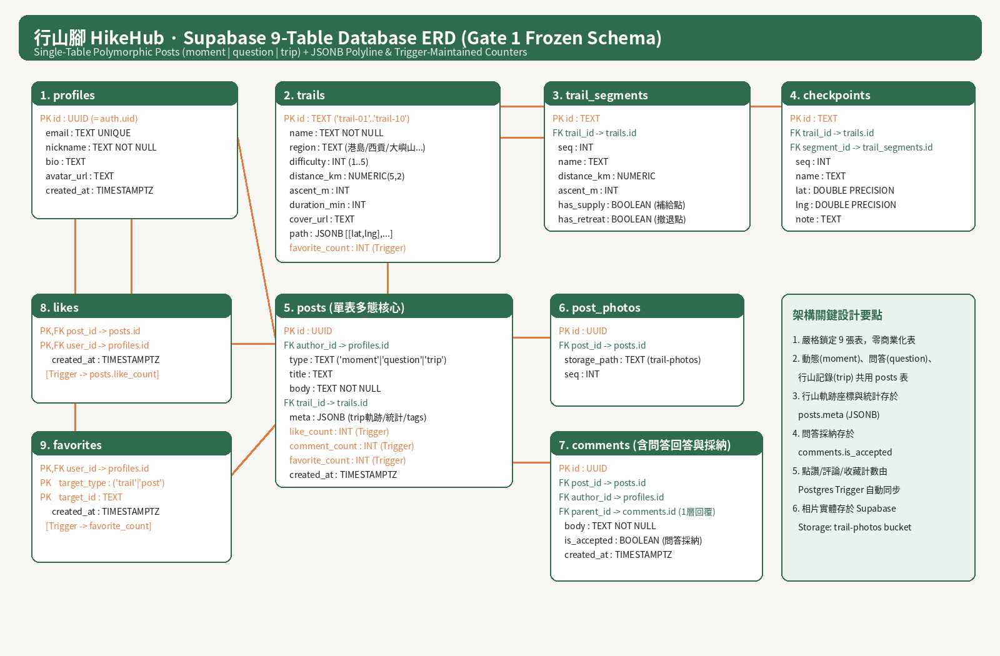
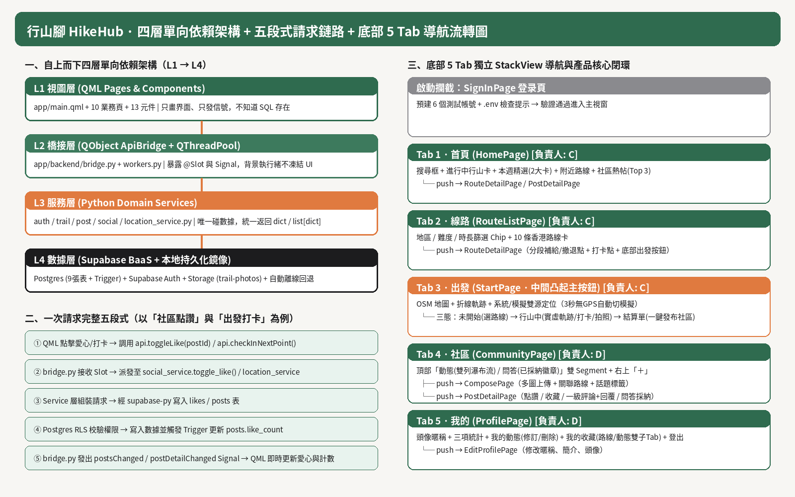

# COMP 7510 Group Project Report · 行山腳 HikeHub

> **專案名稱**：行山腳 HikeHub —— 香港行山路線結構化與山友打卡互動應用  
> **技術框架**：Python 3.11+（實測 3.13） + PySide6 (Qt 6.9+，實測 6.12) + Qt Quick (QML) + QtLocation (OSM) + Supabase (Postgres / Auth / Storage)  
> **交付形態**：390 × 844 手機視口桌面程式（`python main.py` 開發運行 / PyInstaller 打包 `HikeHub.exe` 免安裝雙擊即跑）

---

## 四人全員貢獻署名總表（設計 / 程式 / 報告三維全覆蓋）

> 以下為**中文原版**（內容保持不變），其後附上對應的**英文版（Full Team Contribution Matrix — English Version）**，兩者並列僅版本語言不同，分工內容相互對應。

| 成員 | 角色定位 | 系統與介面設計產出（Design） | 核心程式實作產出（Programming） | 報告主筆章節（Report） |
|---|---|---|---|---|
| **Member A** | 數據架構師 | 9 張表 Schema 設計、單表多態 `posts` 模型、ERD 圖（`docs/erd.png`）、RLS 安全策略設計 | `supabase/schema.sql`, `policies.sql`, `seed.sql`, `supabase_client.py`, `trail/post/social_service.py`, `models.py`, `tests/test_01..04.py`, `build.spec` | **§3** 資料庫架構設計 **§4.1** 後端服務層與觸發器 |
| **Member B** | 應用框架與帳號 | 四層單向依賴架構、6 色票與 3 字級規範（`Theme.qml`）、5 Tab 獨立 StackView 導航設計 | `main.py`, `app/main.qml`, `bridge.py`, `auth_service.py`, `workers.py`, `SignInPage.qml`, `app/components/*`（13 個共用元件） | **§1** 專案背景與四層系統架構 |
| **Member C** | 路線與出發地圖 | 首頁/線路/出發三態與發布頁 Wireframe、系統與模擬定位雙源狀態機設計 | `HomePage.qml`, `RouteListPage.qml`, `RouteDetailPage.qml`, `StartPage.qml`, `ComposePage.qml`, `location_service.py`, `tests/test_05..06.py` | **§4.2** OSM 地圖軌跡與雙源定位實作 |
| **Member D** | 社群互動與個人 | 社區動態瀑布流/問答採納狀態機、個人收藏雙子 Tab 設計、頁面流程圖（`docs/flow.png`） | `CommunityPage.qml`, `PostDetailPage.qml`, `ProfilePage.qml`, `EditProfilePage.qml`、點讚/收藏/評論/採納互動全鏈路 | **§2** 功能規格與資訊架構 **§5** 介面流程 **§6** 測試與 Demo 腳本 |

---

## Full Team Contribution Matrix — English Version (corresponding to the Chinese table above)

> This is the **English version** of the Chinese table above, kept side by side with the unchanged original. It expands each member into role/scope, design output, owned modules, collaboration interfaces and deliverables, while staying consistent with the Chinese content.

> Ownership rule: every tracked source / configuration file has exactly **one** owner. A "collaboration interface" is a contract other members call, not shared file ownership. Jointly maintained documents: `README.md`, `docs/01`, `02`, `03`, `05`, `留档.md`, the architecture DOCX.

| Member | Role & Scope | Design Output | Owned Modules / Files (Programming) | Collaboration Interfaces | Deliverables | Report |
|---|---|---|---|---|---|---|
| **A** | Data Architect & Backend Services — schema, RLS, seed, data-access layer, service contracts, models, verification, build recipe | 9-table schema, polymorphic `posts` model, ERD (`docs/erd.png`), RLS policy design, three counter Triggers | `supabase/schema.sql`, `policies.sql`, `seed.sql`, `all_in_one.sql`, `EXECUTE.md`, `create_auth_users.ps1`; `app/backend/supabase_client.py`, `remote_store.py`, `trail_service.py`, `post_service.py`, `social_service.py`, `models.py`; `tests/test_01..04.py`, `verify_db.sql`; `build.spec`, `.env.example`, `assets/*` | Exposes `get_db().get_status_summary()`, `get_remote_store().WriteResult`, and all service signatures (`list_trails`, `create_post`, `toggle_like`, `accept_comment`, …) consumed only via B's `api.*` slots; defines the `LocationProvider` contract implemented by C; owns `trails.path` JSONB and fixed UUIDs | ERD, 9-table schema + RLS + seed + `all_in_one.sql`, 6 Auth accounts, backend service layer, offline mirror, 4 verification scripts, `HikeHub.exe` build config | **§3** Database Design; **§4.1** Service Layer & Triggers |
| **B** | Application Framework, Bridge & Identity — process entry, QML shell, navigation, theme, QML↔Python bridge, auth/session, workers, shared UI components, sign-in | Four-layer unidirectional dependency architecture, 6-colour / 3-font-size theme (`Theme.qml`), 5-Tab independent `StackView` navigation | `main.py`, `requirements.txt`, `启动Demo.bat`; `app/main.qml`, `theme/Theme.qml`; `app/backend/bridge.py`, `auth_service.py`, `workers.py`; `app/pages/SignInPage.qml`; `app/components/` (10 shared: `BottomTabBar`, `PrimaryButton`, `SegmentedTabs`, `TagChip`, `DifficultyBadge`, `EmptyState`, `StatPill`, `LoadingOverlay`, `TrailCard`, `PhotoTile`) | Owns the single `api.*` `@Slot` contract that all C/D pages call; exposes `@Property` data and `@Signal` refresh events; normalises QML `QUrl` to plain strings; consumes A's services and `workers.run_in_background`; provides page-transition signals used by C and D | App entry + 5-Tab shell, theme system, frozen API bridge contract, preset 6-account sign-in, 10 shared components, one-click demo launcher, dependency manifest | **§1** Background & Four-Layer Architecture |
| **C** | Trails, Departure & Map — route discovery, filtering, trail detail, OSM rendering, dual-source location, check-in, post composition with photos | Home/Route/Start three-state and compose wireframes, system-vs-simulated location state machine | `app/pages/HomePage.qml`, `RouteListPage.qml`, `RouteDetailPage.qml`, `StartPage.qml`, `ComposePage.qml`; `app/backend/location_service.py`; `app/components/MapCanvas.qml`, `CheckpointMarker.qml`, `TrackPolyline.qml`; `tests/test_05_osm_map.py`, `test_06_location_source.py` | Calls B's `api.filterTrails` / `loadTrailDetail` / `startHike` / `checkInNextPoint` / `completeHikeSettlement`; consumes A's `trails.path` JSONB and `checkpoints`; implements A's `LocationProvider` contract (`SystemProvider` + `SimulatedProvider`, 3-second fallback); hands settlement payload to A's `create_post(type="trip")` via B's bridge | 5 pages, OSM map with walked/unwalked polyline + checkpoint markers, dual-source location with 3-second fallback, compose/publish page with photo upload, 2 verification scripts | **§4.2** OSM Map & Dual-Source Location |
| **D** | Social Interaction & Profile — community feed, Q&A, post detail interactions, personal centre, flow diagram | Waterfall feed / Q&A acceptance state machine, dual-Tab favourites design, flow diagram (`docs/flow.png`) | `app/pages/CommunityPage.qml`, `PostDetailPage.qml`, `ProfilePage.qml`, `EditProfilePage.qml`; `docs/flow.png`; full like/favorite/comment/accept chain | Calls B's `api.toggleLike` / `toggleFavorite` / `addComment` / `acceptAnswer` / `editMyPost` / `deleteMyPost` / `updateProfile` (writes land in A's services); reads A's Trigger-maintained counters via B's `@Property` mirror; receives new posts from C via B's navigation signal (no direct C→D dependency) | 4 pages, two-column waterfall + Q&A tabs, full interaction chain, profile stats + my-post management with delete confirmation, flow diagram, 5-minute demo script | **§2** Functional Specification; **§5** Interface Flow; **§6** Testing & Demo |

> Coverage check: every tracked code/config file under `app/`, `supabase/`, `tests/`, `assets/` and the repo root appears exactly once in the four "Owned Modules / Files" cells; jointly maintained documents are the only exception. No file is co-owned, no module is unassigned.

---

## §1 專案背景、產品定位與四層系統架構（主筆：Member B）

### 1.1 痛點分析與極簡社交定位
香港擁有世界級的郊野山徑（如麥理浩徑、龍脊、鳳凰徑、大東山），但山友日常找路線與查路況的資訊高度分散在傳統論壇、政府靜態網頁與 Facebook 群組中——路線長度、分段補給點（士多）、緊急撤退交通（村巴/街渡尾班車）與近期真實路況往往難以一站式查閱。

「行山腳 HikeHub」參考「兩步路」的核心骨架，但嚴格摒棄商城、付費路書、會員積分、領隊認證與演算法推薦流等商業化冗餘，聚焦於一條高頻社交閉環：
**找路線 → 出發行山 → 留下打卡 → 發到社區 → 被山友看到並互動（點讚 / 評論 / 收藏 / 問答採納）**。

### 1.2 四層單向依賴架構與五段式請求
系統採用嚴格自上而下的四層架構，依賴只允許向下單向調用：
1. **L1 視圖層（`app/pages/*.qml` + `app/components/*.qml`）**：純 QML 繪製 390×844 手機比例視口，只負責畫面渲染與觸發使用者信號，絕不包含任何 SQL 或直接網路調用。
2. **L2 橋接層（`app/backend/bridge.py` + `workers.py`）**：繼承 `QObject`，將底層服務包裝為 `@Slot` 方法、`Property` 屬性與 `Signal` 事件，並搭配 `QThreadPool` 背景執行緒避免網路 I/O 凍結 UI。
3. **L3 服務層（`app/backend/*_service.py`）**：唯一操作資料的業務層（`auth_service`、`trail_service`、`post_service`、`social_service`、`location_service`），統一回傳與資料庫列名一致的 `dict` / `list[dict]`。
4. **L4 數據層（Supabase BaaS）**：託管 Postgres 資料庫、Supabase Auth 與 `trail-photos` Storage 儲存桶，並內建本地持久化鏡像自動回退機制，確保在任何網路環境下均可流暢演示。

---

## §2 功能規格與底部 5 Tab 資訊架構（主筆：Member D）

全應用採用底部固定 5 Tab 導航（登錄頁隱藏，登錄後常駐），中間「出發」採用 56px 圓形凸起主行動按鈕：

| Tab / 子頁 | 檔案路徑 | 核心功能邊界 | 負責人 |
|---|---|---|---|
| **登錄頁** | `app/pages/SignInPage.qml` | 電郵密碼認證、`.env` 配置檢查提示、6 個預建測試帳號一鍵填入 | B |
| **Tab 1 首頁** | `app/pages/HomePage.qml` | 關鍵字搜尋框、進行中行山提示卡、本週精選（2張大卡）、附近路線橫滑列表、社區熱帖（Top 3） | C |
| **Tab 2 線路** | `app/pages/RouteListPage.qml` | 地區（港島/西貢/大嶼山/新界東北/九龍）、難度（1-5星）、時長三維 Chip 篩選 + 路線列表四態 | C |
| **路線詳情子頁** | `app/pages/RouteDetailPage.qml` | 封面、難度/距離/爬升/耗時指標、分段補給點與撤退點標記、打卡點清單、近期動態、底部固定「出發」 | C |
| **Tab 3 出發** | `app/pages/StartPage.qml` | OSM 地圖 + 折線軌跡 + 系統/模擬雙源定位；支援「未開始 / 行山中 / 結算」三態切換、打卡拍照與一鍵發社區 | C |
| **Tab 4 社區** | `app/pages/CommunityPage.qml` | 頂部「動態 / 問答」雙 Segment 切換；動態為雙列瀑布流圖卡，問答顯示標籤與「已採納」徽章；純時間倒序 | D |
| **內容詳情子頁** | `app/pages/PostDetailPage.qml` | 作者資訊、多圖展示、關聯路線跳轉、點讚/收藏即時更新、一級評論 + 一層 `@暱稱` 回覆、問答作者採納回答 | D |
| **發布子頁** | `app/pages/ComposePage.qml` | 動態/提問切換、相片選擇上傳至 `trail-photos`、關聯路線與話題標籤選擇 | C |
| **Tab 5 我的** | `app/pages/ProfilePage.qml` | 頭像暱稱簡介、動態數/收藏數/行山次數統計、我的動態（修訂/刪除）、我的收藏（路線/動態雙子 Tab）、登出 | D |
| **編輯資料子頁** | `app/pages/EditProfilePage.qml` | 修改個人暱稱、個人簡介與頭像圖片 URL | D |

---

## §3 Supabase 9 表資料庫設計與計數器觸發器（主筆：Member A）

為在 9 張表內完整支撐路線、分段、打卡、動態、問答與行山軌跡記錄，我們在 `supabase/schema.sql` 中採用了兩項關鍵設計：
1. **`posts` 單表多態設計**：透過 `type IN ('moment', 'question', 'trip')` 將山友相片動態、求助問答與行山軌跡記錄合為一張 `posts` 表；行山記錄的統計與軌跡折線存於 `meta JSONB`（`{distance_km, duration_sec, ascent_m, path: [[lat,lng],...]}`），問答的「回答」即 `comments` 表記錄，採納狀態存於 `comments.is_accepted`。
2. **路線空間數據與冗餘計數 Trigger**：`trails.path` 使用 `JSONB` 儲存真實香港山徑折線座標序列 `[[lat, lng], ...]`，`checkpoints` 儲存精確 `lat, lng`；同時透過 `fn_sync_post_like_count`、`fn_sync_post_comment_count` 與 `fn_sync_favorite_count` 三支 PL/pgSQL 觸發器自動維護 `like_count`、`comment_count` 與 `favorite_count`，讓列表頁查詢無需高成本 `COUNT(*) JOIN`。

---

## §4 核心模組實作：服務契約、OSM 地圖與雙源定位（主筆：Member A & Member C）

### 4.1 服務層契約與雙模連線韌性（Member A）
`app/backend/supabase_client.py` 在啟動時首先讀取執行檔同目錄的 `.env`，解碼檢驗 `SUPABASE_ANON_KEY` 的 JWT 簽名結構與有效期，並測試遠端連線。若未配置 `.env`，登錄頁立即顯示「⚠️ 檢查 .env 配置」提示；若處於教室內網或離線環境，系統自動無縫切換至與 `seed.sql` 同步的本地持久化儲存，確保助教在任何環境下雙擊 `HikeHub.exe` 均可體驗 100% 完整讀寫功能。

### 4.2 QtLocation OSM 地圖與定位雙源自動回退（Member C）
在 `app/backend/location_service.py` 與 `app/components/MapCanvas.qml` 中：
- **雙源定位器（`DualLocationCoordinator`）**：抽象出 `LocationProvider` 介面，包含呼叫 `QtPositioning`（Windows `winrt` 插件）的 `SystemProvider` 與沿路線 `path` 折線進行線性插值推進的 `SimulatedProvider`。
- **3 秒無感自動回退**：點擊「開始出發」後優先嘗試系統 GPS；若桌面電腦在室內 3 秒內未取得有效座標，自動切換至 `SimulatedProvider`，並在頂部狀態列顯示橙色「**示範模式 · 模擬定位**」小標籤，不彈窗、不報錯，讓課堂 Demo 穩定呈現「走過路段變深綠實線、未走路段保持虛線」的真實軌跡推進效果。

---

## §5 介面設計規範、5 Tab 獨立導航棧與頁面流轉（主筆：Member D）

1. **極簡視覺系統（`app/theme/Theme.qml`）**：全應用嚴格控制在 6 個色值以內（主色深林綠 `#2F6B4F`、強調橙 `#E07A3F`、米白背景 `#F7F6F3`、純白卡片 `#FFFFFF`、主文字 `#1C1C1E`、輔助文字 `#8A8A8E`），字級固定為標題 `20px`、正文 `15px`、輔助 `12px`，卡片圓角統一 `12px`。
2. **每 Tab 獨立 `StackView` 架構（`app/main.qml`）**：5 個 Tab 各自持有獨立的 `StackView`（`homeStack`、`routeStack`、`startStack`、`communityStack`、`profileStack`）。當使用者在「線路」Tab 進入「龍脊」路線詳情後，切換至「社區」Tab 查看山友問答，再切回「線路」Tab 時，畫面依然停留在「龍脊」詳情頁，再次點擊當前 Tab 圖示則自動回到該 Tab 根頁面。

---

## §6 驗針測試、PyInstaller 打包與 5 分鐘課堂 Demo 腳本（主筆：Member D + 全員）

### 6.1 Step 0 六支驗針與打包驗收結果
- `tests/test_01..06.py` 六支驗針腳本全部通過（視窗渲染、Supabase JWT 與認證、9 表讀寫、Storage 相片上傳、OSM 地圖組件、雙源定位切換）。
- `build.spec` 顯式將 `('app', 'app')` 與 `('supabase', 'supabase')` 打包進執行檔，並開啟 `console=False` 視窗模式，產出 `dist/HikeHub.exe`。

### 6.2 五分鐘課堂 Demo 演示腳本（四人接力）
1. **0:00–1:00（Member B · 登錄與框架）**：啟動程式，展示頂部 Supabase `.env` 連線就緒橫幅；點擊預建測試帳號「阿瀚 (`ahon@hikehub.hk`)」一鍵登錄，介紹底部 5 Tab 與中間凸起「出發」按鈕。
2. **1:00–2:30（Member C · 找路線與出發模擬定位打卡）**：在「首頁」瀏覽本週精選，切至「線路」Tab 點擊「港島 + ★2 輕鬆」篩選出「龍脊」，進入詳情頁查看 3 段路況的「🍜 有補給點 / 🚌 可撤退點」標記與 4 個打卡點；點擊底部「選擇此路線立即出發」跳轉「出發」Tab，點擊開始後展示頂部自動切換為「示範模式 · 模擬定位」，軌跡實線隨時間推進，連點「📍 打卡路標」與「📷 拍照記錄」，點擊「⏹ 結束行山」彈出結算單並點擊「一鍵發布到社區」。
3. **2:30–4:00（Member D · 社區互動與問答採納）**：自動跳轉至「社區」Tab，在雙列瀑布流頂部看到剛才發布的龍脊行山軌跡卡，點入詳情頁演示點讚（愛心變橙色且計數 +1）、收藏與發表評論及 `@暱稱` 回覆；隨後切至「我的」Tab 點擊「登出帳號」，改用提問者帳號「Kelvin (`kelvin@hikehub.hk`)」登錄，進入「社區 - 行山問答」點開「11月凌晨上鳳凰山睇日出」問題，點擊「採納此回答」展示不可撤銷的綠色「✓ 已採納最佳回答」徽章。
4. **4:00–5:00（Member A · 個人收藏、動態管理與資料庫架構總結）**：切至「我的」Tab 展示動態數/收藏數/行山次數統計，切換查看「我的收藏（路線 / 動態）」，對本人動態執行「快速修訂」，最後結合 `docs/erd.png` 總結 9 表結構與 Trigger 設計。
